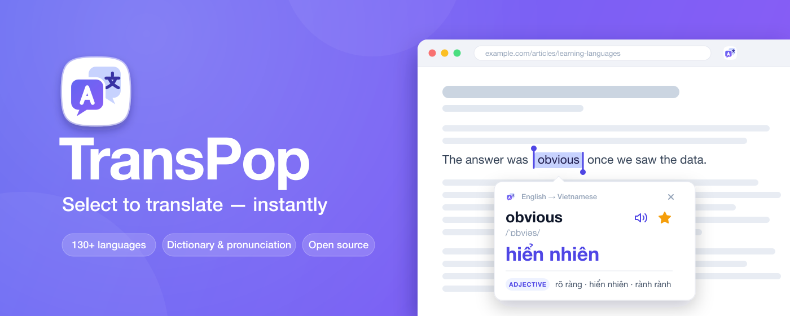
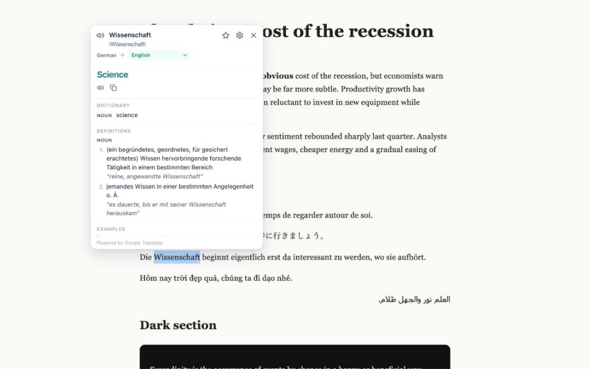
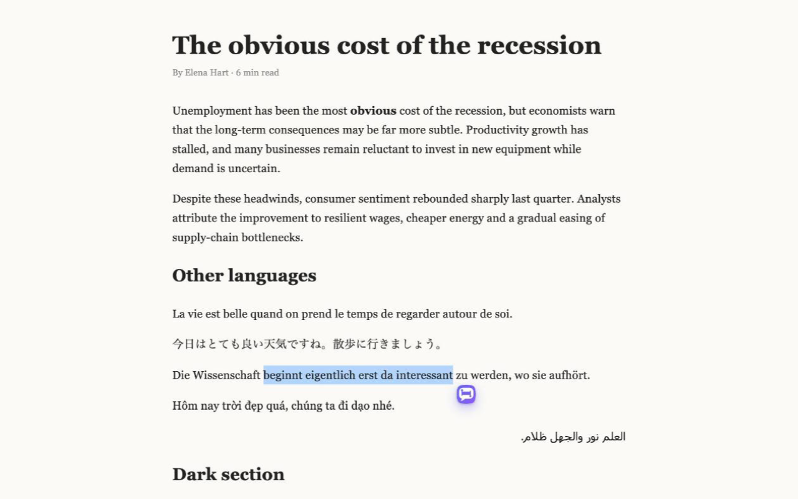
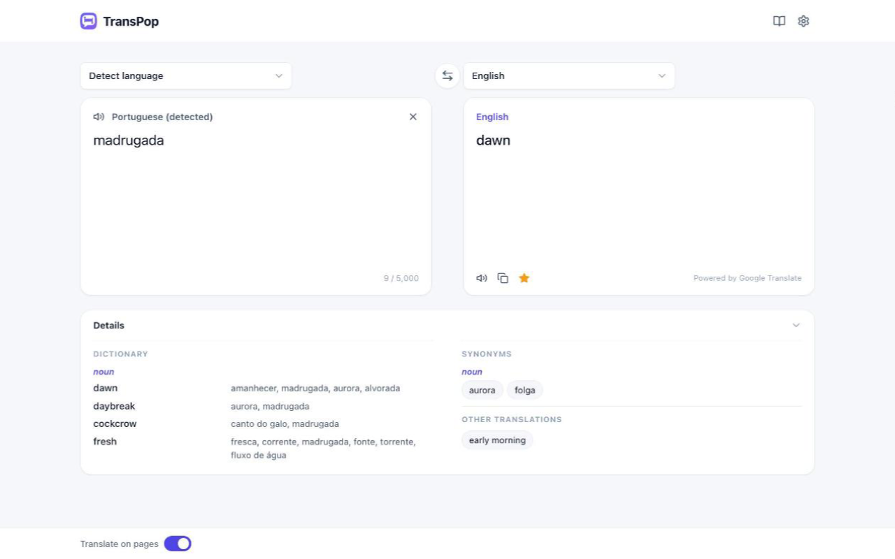
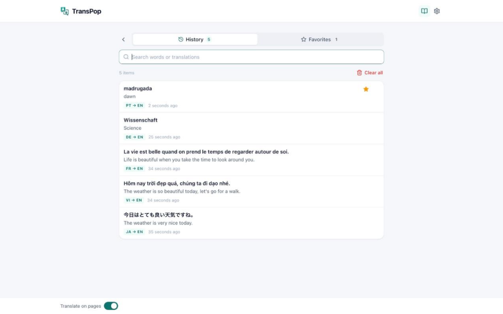
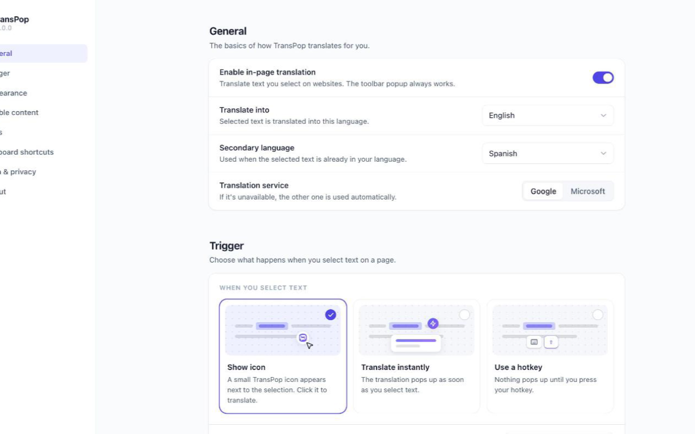

<p align="center">
  
</p>

<h1 align="center">TransPop</h1>

<p align="center">
  <b>Select to translate.</b> Select any word or phrase on a web page — the translation appears right next to it.<br>
  Dictionary, pronunciation, history and favorites. 130+ languages. Free, open source, private.
</p>

<p align="center">
  <a href="LICENSE"></a>
  <a href="https://developer.chrome.com/docs/extensions/develop/migrate/what-is-mv3"></a>
  <a href="https://github.com/PhamTienThanhCong/transpop/actions/workflows/ci.yml"></a>
  <a href="https://chromewebstore.google.com/detail/EXTENSION_ID"></a>
</p>

<p align="center">
  
</p>

<p align="center"><a href="#tiếng-việt">🇻🇳 Tiếng Việt</a></p>

---

## Features

- **Translation bubble on any page** — select text and a clean translation card appears next to it. Works in
  iframes, on dark sites, right-to-left pages and sites with strict CSP. It lives in a Shadow DOM, so it never
  breaks the page.
- **Three trigger modes** — **Icon** (default, a small TransPop button appears near the selection), **Auto** (the
  bubble opens immediately, optionally on double-click only), or **Hotkey** (hold or tap Shift / Alt / Ctrl / ⌘).
- **Dictionary for words & short phrases** — phonetics, parts of speech with alternative translations,
  definitions, example sentences and synonyms.
- **Pronunciation** — listen to the original text and the translation; optional auto-pronounce.
- **Translator popup** — full translator with language detection, swap, dictionary and a full-page view.
- **History & favorites** — searchable, exportable to CSV, stored only on your device.
- **130+ languages** with *smart swap*: text that's already in your language goes to your secondary language.
- **Reliable** — Google Translate by default with automatic fallback to Microsoft Translator.
- **Yours to control** — light/dark/auto theme, font size, which sections to show, disable on specific sites or
  pause everywhere from the toolbar icon's menu.
- **Localized** — English and Vietnamese UI.
- **Private** — no analytics, no tracking, no ads, no remote code. See the [privacy policy](docs/PRIVACY.md).

## Screenshots

| | |
|---|---|
|  |  |
|  |  |
|  | |

## Install

**From the Chrome Web Store** (recommended): [TransPop on the Chrome Web Store](https://chromewebstore.google.com/detail/EXTENSION_ID)
— works in Chrome, Edge, Brave and other Chromium browsers (version 116+).

**From source / a release zip** (developer mode):

1. Download the source (`git clone https://github.com/PhamTienThanhCong/transpop.git`) or the `transpop-v*.zip` from
   [Releases](https://github.com/PhamTienThanhCong/transpop/releases) and unzip it.
2. Open `chrome://extensions` and turn on **Developer mode** (top right).
3. Click **Load unpacked** and select the **`extension/`** folder (the folder that contains `manifest.json`;
   for a release zip, the unzipped folder itself).
4. Pin TransPop from the 🧩 menu so its icon is always visible.

## Usage

| How | What happens |
|---|---|
| Select text → click the **TransPop button** | Opens the translation bubble (default *Icon* mode) |
| Select text (Auto mode) | The bubble opens right away |
| Hold/tap your **modifier key** while selecting (Hotkey mode) | The bubble opens only when you ask |
| Right-click a selection → **Translate “…”** | Opens the bubble for that text |
| Click the toolbar icon | Opens the translator popup (history & favorites inside) |
| Right-click the toolbar icon | Turn TransPop off on the current site, or pause it everywhere |

Keyboard shortcuts (change them at `chrome://extensions/shortcuts`):

| Shortcut | Action |
|---|---|
| `Alt`+`Shift`+`T` (macOS: `⌥⇧T`) | Open the translator popup |
| `Alt`+`Shift`+`S` (macOS: `⌥⇧S`) | Translate the current selection |
| *(not set by default)* | Turn in-page translation on/off |

Inside the bubble: 🔊 listen (original and translation) · copy · ⭐ add to favorites · switch the target
language · ⚙ settings.
Settings: the ⚙ button in the popup or bubble, or right-click the toolbar icon → *Options*.

## Privacy

TransPop sends text **only** to the translation provider, **only** when you ask for a translation. Settings live in
`chrome.storage.sync`, history and favorites in `chrome.storage.local` — nothing is ever sent to the developer.
No analytics, no ads, no tracking. Full policy: [docs/PRIVACY.md](docs/PRIVACY.md).

## Development

> **Branches:** `main` is the product branch — only the extension and the essentials. All development happens on
> [`dev`](https://github.com/PhamTienThanhCong/transpop/tree/dev), which also holds the build/test tooling, the
> dev harness and the guides. Clone `dev` to contribute and open pull requests against `dev`.

No build step, no frameworks, no npm dependencies — plain ES2022, HTML and CSS. The `extension/` folder is loaded
unpacked and zipped as-is. You need **Node.js 22+** (for the scripts and tests) and **Chrome 116+**.

```bash
git clone -b dev https://github.com/PhamTienThanhCong/transpop.git && cd transpop
npm run check      # validate manifest, file references, MV3/CSP rules, i18n keys
npm test           # unit tests (node --test)
```

| Script | What it does |
|---|---|
| `npm run i18n` | Build `extension/_locales/*/messages.json` from the `i18n/*.json` fragments |
| `npm run check` | Static checks: manifest + referenced files, `node --check` on every JS file, no inline scripts / `eval` / remote code, all i18n keys defined, locales up to date |
| `npm test` | Unit tests in `tests/**/*.test.{js,mjs}` (providers, translator, cache, TTS…) |
| `npm run package` | i18n + check, then zip `extension/` into `dist/transpop-v<version>.zip` |
| `npm run dev` | Local dev server to preview the extension pages with a mocked `chrome.*` API |
| `npm run icons` | Re-render all PNG icons and store graphics from the SVG sources (needs `rsvg-convert`) |

Day-to-day: load `extension/` unpacked, edit, then hit ↻ on `chrome://extensions` and refresh the tab.

### Project structure

```
extension/                 ← the extension (load unpacked / zipped as-is)
├─ manifest.json
├─ _locales/{en,vi}/       generated by `npm run i18n` — don't edit by hand
├─ icons/                  toolbar/app icons + logo.svg, logo-mark.svg
└─ src/
   ├─ shared/              constants, languages, storage, messaging, i18n (ES modules)
   ├─ ui/                  design tokens (CSS variables), theme, inline SVG icon set
   ├─ background/          service worker: translator + providers (pure, Node-testable), TTS, context menus
   ├─ offscreen/           offscreen document for audio playback
   ├─ content/             content script: selection detection, trigger button, bubble (Shadow DOM)
   ├─ popup/               toolbar popup + full-page translator, history & favorites
   ├─ options/             settings page
   └─ welcome/             onboarding page shown on install
i18n/                      translation sources, one JSON fragment per area
scripts/                   build-locales, check, package, dev-server
tests/                     node --test unit tests
docs/                      ARCHITECTURE, PUBLISHING (vi), PRIVACY, STORE_LISTING
store-assets/              store icon, promo tiles, screenshots (+ SVG sources)
```

The full contract — messaging, settings schema, provider details, design tokens — is in
[docs/ARCHITECTURE.md](https://github.com/PhamTienThanhCong/transpop/blob/dev/docs/ARCHITECTURE.md).

### Translating the UI

UI strings live in `i18n/<area>.json` fragments:

```json
{ "popup_translate": { "en": "Translate", "vi": "Dịch", "description": "Primary button" } }
```

To add a language, add its code (e.g. `"fr": "Traduire"`) to the entries in every fragment, run `npm run i18n`
and open a pull request. Missing strings fall back to English. See [CONTRIBUTING.md](https://github.com/PhamTienThanhCong/transpop/blob/dev/CONTRIBUTING.md).

### Releasing

Step-by-step Chrome Web Store guide (Vietnamese): [docs/PUBLISHING.md](https://github.com/PhamTienThanhCong/transpop/blob/dev/docs/PUBLISHING.md).
Ready-to-paste listing text: [docs/STORE_LISTING.md](https://github.com/PhamTienThanhCong/transpop/blob/dev/docs/STORE_LISTING.md).
Pushing a tag `vX.Y.Z` on `dev` builds the zip and attaches it to a GitHub Release.

## Credits

- Icons adapted from [Lucide](https://lucide.dev) (ISC License).
- Translations are provided by Google Translate and Microsoft Translator through their free, **unofficial** web
  endpoints, which may change or stop working at any time. TransPop is an independent project and is **not
  affiliated with, endorsed by or sponsored by Google or Microsoft**. All trademarks belong to their owners.

## License

[MIT](LICENSE) © 2026 TransPop contributors

---

## Tiếng Việt

**TransPop — Bôi đen là dịch.** Tiện ích Chrome mã nguồn mở: bôi đen từ hoặc câu bất kỳ trên trang web, bản dịch hiện
ngay bên cạnh trong một bong bóng gọn gàng (giống DDict). Có cửa sổ dịch đầy đủ với từ điển, định nghĩa, ví dụ, phát
âm, lịch sử và mục yêu thích; hỗ trợ hơn 130 ngôn ngữ; giao diện tiếng Việt và tiếng Anh.

- **Cài đặt:** từ [Chrome Web Store](https://chromewebstore.google.com/detail/EXTENSION_ID), hoặc tải mã nguồn →
  `chrome://extensions` → bật *Chế độ dành cho nhà phát triển* → *Tải tiện ích đã giải nén* → chọn thư mục `extension/`.
- **Cách dùng:** bôi đen → bấm nút TransPop nhỏ (hoặc chọn chế độ *Tự động* / *Phím tắt* trong Cài đặt). Phím tắt:
  `Alt+Shift+T` mở cửa sổ dịch, `Alt+Shift+S` dịch đoạn đang chọn. Chuột phải vào đoạn đã chọn → *Dịch “…”*.
- **Quyền riêng tư:** chỉ gửi đoạn văn bản bạn yêu cầu dịch tới dịch vụ dịch; cài đặt, lịch sử, yêu thích chỉ lưu
  trong trình duyệt; không quảng cáo, không theo dõi. Xem [chính sách](docs/PRIVACY.md#tiếng-việt).
- **Phát hành lên Chrome Web Store:** hướng dẫn chi tiết từng bước bằng tiếng Việt tại
  [docs/PUBLISHING.md](https://github.com/PhamTienThanhCong/transpop/blob/dev/docs/PUBLISHING.md).
- **Nhánh:** `main` là bản product (chỉ extension và những file cần thiết); mọi phát triển, test và hướng dẫn nằm ở
  nhánh [`dev`](https://github.com/PhamTienThanhCong/transpop/tree/dev).
- **Đóng góp:** xem [CONTRIBUTING.md](https://github.com/PhamTienThanhCong/transpop/blob/dev/CONTRIBUTING.md) — mọi góp ý, báo lỗi, bản dịch giao diện đều được chào đón.
